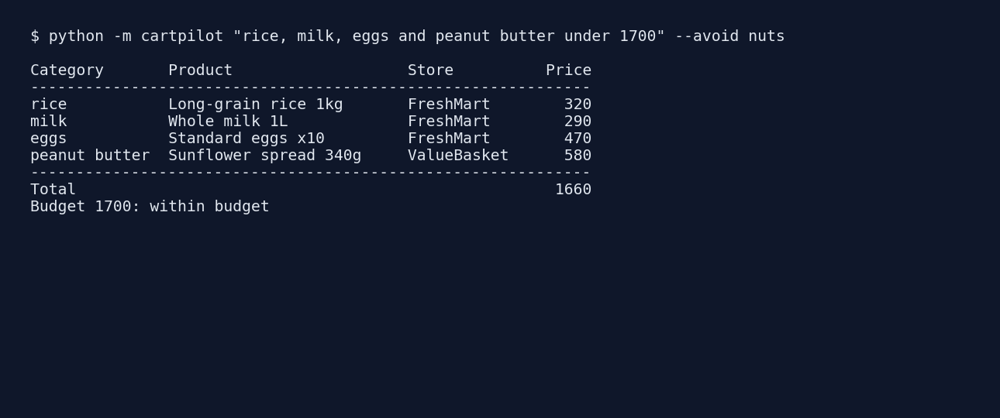
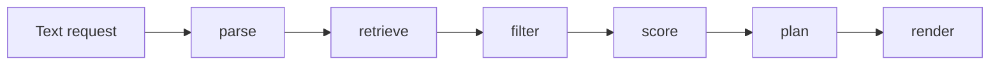

# CartPilot

Describe a shopping list in plain language; CartPilot picks a basket that respects your allergens, delivery distance and budget. Pure Python, standard library only. No API keys, no network



## How it works




1. **parse** finds known product categories and an optional budget ("under 1,700")
2. **retrieve** reads candidate products from an in-memory SQLite catalog
3. **filter** drops products with an avoided tag (e.g. `nuts`) or beyond `max_distance_km`
4. **score** ranks candidates inside each category: price 45%, rating 25%, distance 20%, preferred brand 10%
5. **plan** takes the top-scoring item per category. If the basket is over budget, it repeatedly swaps in the cheaper alternative that loses the least score per unit saved until it fits or nothing cheaper exists
6. **render** prints the table and says whether the budget was met

## Usage

```bash
python -m cartpilot "rice, milk and eggs under 1200" --avoid nuts --brands Golden --max-km 8
python -m unittest discover -s tests -t .
```

```python
from cartpilot import plan_basket, Profile
result = plan_basket("bread and milk", Profile(avoid_tags={"gluten"}))
```

## Layout

```
cartpilot/
  models.py    dataclasses (Product, Profile, Request, Pick)
  catalog.py   SQLite demo catalog (fictional stores and prices)
  parser.py    rule-based request parser
  scoring.py   per-category scoring
  planner.py   budget-aware swap planner
  engine.py    pipeline + text rendering
tests/         unit tests
```
